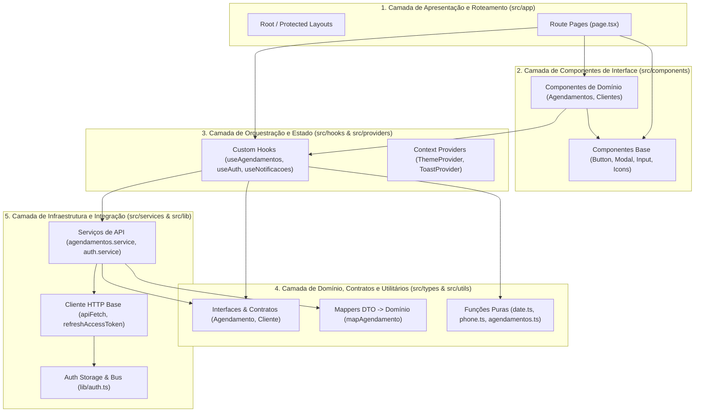

# Padrões Arquiteturais da Aplicação

Este documento analisa as diretrizes arquiteturais que regem o projeto, classificando formalmente seu padrão, demonstrando o fluxo de dados e delimitando os níveis de acoplamento entre módulos.

---

## 1. Classificação do Padrão Arquitetural

### Padrão Identificado: **Layered Modular Frontend Architecture (Arquitetura Modular em Camadas para Aplicação Web)**

A aplicação organiza seu código em **cinco camadas funcionais sobrepostas**, com comunicação predominantemente **unidirecional** e isolamento claro entre a interface do usuário e o acesso a dados externos.

### O que esta arquitetura NÃO é (Evidências Concretas):
- **NÃO é Clean Architecture (Arquitetura Limpa clássica)**: Não existem classes de entidades com lógica encapsulada, casos de uso (*use cases*) como classes abstratas, interfaces de repositório (*ports*) nem containers de injeção de dependência invertida (*Dependency Inversion Principle* estrito).
- **NÃO é Domain-Driven Design (DDD) tático**: Não há entidades ricas, objetos de valor com métodos de validação acoplados a instâncias, agregações (*aggregates*), eventos de domínio ou repositórios tipados por domínio.
- **NÃO é MVC tradicional**: O estado não é sincronizado por controladores de ciclo de vida bidirecional; o estado é reativo e orquestrado por hooks React no cliente.

### O que ela É:
Uma arquitetura **modular, em camadas, orientada a dados e orientada a componentes**, comum em ecossistemas modernos React / Next.js, onde a separação de responsabilidades é alcançada por funções assíncronas puras, hooks de orquestração de ciclo de vida e componentes desacoplados de persistência.

---

## 2. As Cinco Camadas Arquiteturais

---

## 3. Descrição Detalhada das Camadas

| Camada | Diretórios | Papel Principal | Depende de | É consumida por |
| :--- | :--- | :--- | :--- | :--- |
| **1. Apresentação / Roteamento** | `src/app/` | Declarar páginas, capturar parâmetros de URL assíncronos (`use(params)`), definir proteção de rota via layout. | Componentes, Hooks, Providers, Types | Next.js Router |
| **2. Componentes de Interface** | `src/components/` | Renderizar estrutura de tela, coletar inputs do usuário, disparar callbacks de ação. | Componentes Base, Hooks, Types, Utils | Camada de Apresentação |
| **3. Orquestração e Estado** | `src/hooks/`, `src/providers/` | Isolar efeitos assíncronos (`useEffect`), polling de dados, ciclo de vida de requisição e persistência local. | Serviços, Utilitários, Tipos | Componentes, Páginas |
| **4. Domínio e Utilitários** | `src/types/`, `src/utils/` | Fornecer interfaces de dados, mappers para sanitizar respostas de API, cálculos e formatações sem efeitos colaterais. | Nenhuma camada externa (camada pura) | Todas as camadas |
| **5. Infraestrutura e Gateways** | `src/services/`, `src/lib/` | Realizar chamadas HTTP (`fetch`), anexar tokens de autorização, tratar interceptação de 401 e gerenciar armazenamento bruto (`localStorage`). | Variáveis de ambiente, contratos de tipo | Hooks, Layouts de proteção |

---

## 4. Fluxo de Comunicação Unidirecional

O fluxo de dados da aplicação segue uma direção estrita da interface para a infraestrutura durante a leitura ou mutação, e retorna via promessas/estado reativo:

1. **Invocação do Usuário**: Uma ação de usuário (ex: abrir página de agendamentos ou salvar novo registro) ocorre em `src/app/(painel)/agendamentos/` ou `src/components/Agendamentos/`.
2. **Orquestração pelo Hook**: O componente aciona um método de hook (ex: `useAgendamentos` ou `criar(data)`).
3. **Chamada de Serviço**: O hook delega a operação assíncrona para a função de serviço correspondente em `src/services/agendamentos.service.ts`.
4. **Envio via Cliente HTTP**: A função de serviço chama `apiFetch` (`src/services/api.ts`), que:
   - Recupera o token de `src/lib/auth.ts`.
   - Injeta o cabeçalho `Authorization: Bearer <token>`.
   - Em caso de 401, aciona `refreshAccessToken()`, persiste o novo token e repete a chamada.
5. **Sanitização de Contrato (Mappers)**: A resposta do backend é transformada de envelope Strapi (`data`) para o formato do domínio através de funções como `mapAgendamento` ou `mapNotificacao`.
6. **Atualização Reativa do Estado**: O resultado é atribuído ao estado React local (`useState`) no hook, provocando re-renderização na interface.

---

## 5. Limites e Acoplamentos

### Acoplamentos Adequados:
- **Componentes desacoplados de HTTP**: Os componentes visuais e telas não realizam `fetch` diretamente (exceto chamadas simples de inicialização que ainda assim utilizam funções de serviço como `getMe()`).
- **Serviços desacoplados de React**: O diretório `src/services/` não importa hooks nem depende do ciclo de renderização do React; todas as funções de serviço são funções TypeScript assíncronas puras.
- **Utilitários totalmente agnósticos de framework**: O diretório `src/utils/` contém apenas funções utilitárias que podem ser executadas em qualquer ambiente JavaScript/Node sem dependência de DOM ou React.

### Pontos de Atenção e Acoplamentos Rígidos:
- **Acoplamento Forte com a Estrutura Strapi**:
  - Parâmetros como `documentId`, `status_id?.id`, e queries como `filters[agendamento][data][$eq]=...` e `populate=*` estão diretamente codificados dentro dos serviços.
  - Se o backend for substituído por outro formato não-Strapi, a camada `src/services/` e as interfaces em `src/types/` precisarão de adaptação completa.
- **Dependência Direta do Objeto Global `window` no Cliente HTTP**:
  - `src/services/api.ts` invoca `window.location.replace('/login')` no encerramento de sessão, criando uma dependência do ambiente do navegador dentro do serviço HTTP.

---

## 6. Estratégias de Reutilização de Código

1. **Isolamento de Acessibilidade e Portals Headless**:
   - O arquivo `src/components/Modal/shared.tsx` concentra a infraestrutura de acessibilidade de diálogos:
     - `Portal`: Renderização de nós DOM na raiz do `<body>`.
     - `useLockBodyScroll`: Bloqueio de rolagem do elemento `body` ao abrir camadas sobrepostas.
     - `useEscapeKey`: Fechamento por tecla de escape.
     - `useFocusTrap`: Retenção do tabulador dentro do modal e devolução ao gatilho original ao fechar.
   - Esse padrão é reutilizado por `Modal`, `BottomSheet` e indiretamente por `ConfirmDialog`, garantindo consistência sem precisar de bibliotecas externas pesadas.
2. **Filtragem em Memória no Cliente**:
   - Agendamentos são carregados integralmente uma vez (`getAgendamentos()`) e filtrados instantaneamente na interface com `aplicarFiltros(todos, filtros)` dentro de um `useMemo`.
   - Essa decisão prioriza responsividade máxima em redes móveis sem requisições HTTP adicionais a cada toque em abas de filtro.

---

## 7. Recomendações Arquiteturais

1. **Desacoplar Redirecionamento da Camada HTTP**:
   - Em vez de `window.location.replace('/login')` diretamente em `api.ts`, notificar o barramento de eventos de autenticação (`lib/auth.ts`) e deixar a camada de apresentação (`layout.tsx` / `useAuth`) gerenciar o redirecionamento através do roteador do Next.js (`router.replace`).
2. **Centralizar Configurações de API**:
   - Garantir que todos os serviços consumam `API_URL` exclusivamente de `src/services/config.ts`.

