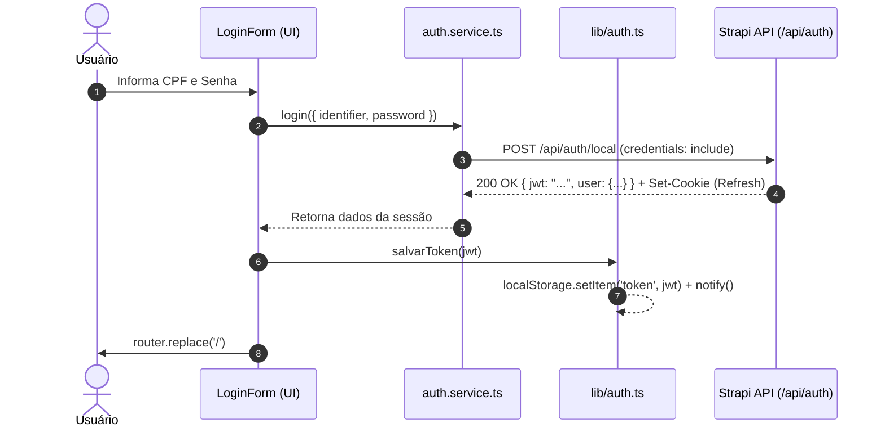
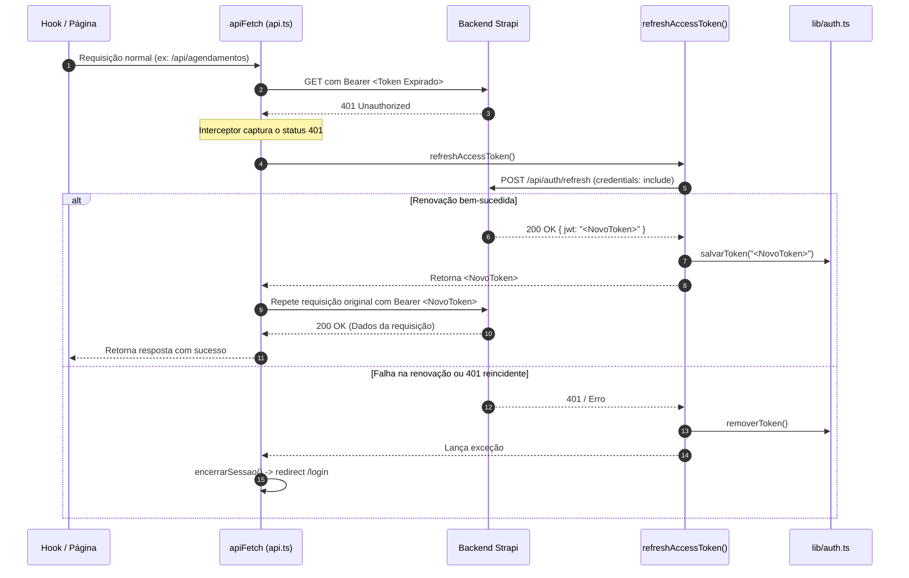

# Autenticação e Autorização (Mecânica Operacional)

Este documento descreve o funcionamento operacional da autenticação, o fluxo de tokens, o barramento de sincronização entre abas e a guarda de rotas implementada no código-fonte atual do projeto.

> [!WARNING]
> **Aviso de Limitações de Segurança**:
> Este documento retrata estritamente a **implementação existente** na aplicação, a qual apresenta fragilidades conhecidas (ex: JWT em `localStorage`, concorrência não tratada no auto-refresh e logout sem revogação no servidor).
> Para a auditoria técnica de segurança no frontend, análise de vulnerabilidades, padrões recomendados (BFF, Single-Flight Mutex, Web Locks com fallback) e checklist de produção, consulte o documento:
> 👉 [**Segurança de Autenticação e Checklist**](authentication-security.md).

---

## 1. Modelo de Sessão Híbrido (Dual-Token no Cliente)

A aplicação utiliza uma estratégia de **dois tokens**:

1. **Access Token (JWT)**:
   - Armazenado no cliente no `localStorage` sob a chave `'token'`.
   - Enviado no cabeçalho `Authorization: Bearer <token>` em todas as requisições autenticadas via `apiFetch`.
   - Possui tempo de expiração curto determinado pelo servidor de autenticação.
2. **Refresh Token**:
   - Trafegado e mantido pelo navegador através de cookies com a flag `credentials: 'include'`.
   - Não é acessível diretamente pelo código JavaScript do frontend se configurado como HTTP-Only no backend.

---

## 2. Fluxo de Autenticação Operacional



### 2.1 Credenciais de Acesso
- O identificador utilizado para login é o **CPF** (normalizado apenas com dígitos numéricos via `apenasDigitos(identifier)`) e a **Senha**.
- O endpoint consumido é o `/api/auth/local` do Strapi.

---

## 3. Renovação Transparente de Token (Auto-Refresh)

O cliente HTTP (`src/services/api.ts`) implementa um interceptor nativo para tratar a expiração do JWT (HTTP 401):



### Código do Interceptor no Projeto (`src/services/api.ts`):
```ts
let response = await makeRequest(obterToken());

if (response.status !== 401) {
  return response;
}

// O token expirou: tenta renovar a sessão
let novoToken: string;
try {
  novoToken = await refreshAccessToken();
} catch (error) {
  throw error;
}

// Repete a requisição original com o novo token
response = await makeRequest(novoToken);

// Se o token renovado também for rejeitado, encerra a sessão
if (response.status === 401) {
  encerrarSessao();
  throw new Error('Sessão expirada. Faça login novamente.');
}

return response;
```

---

## 4. Barramento de Sincronização e Reatividade (`src/lib/auth.ts`)

Para permitir que a interface reaja a alterações no estado de login sem recarregar a página ou criar dependência de bibliotecas de terceiros, `src/lib/auth.ts` implementa um padrão **Observer / Pub-Sub**:

```ts
const TOKEN_KEY = 'token';
type AuthListener = () => void;
const listeners = new Set<AuthListener>();

export function subscribeAuth(callback: AuthListener) {
  listeners.add(callback);
  if (typeof window !== 'undefined') {
    window.addEventListener('storage', callback);
  }
  return () => {
    listeners.delete(callback);
    if (typeof window !== 'undefined') {
      window.removeEventListener('storage', callback);
    }
  };
}

function notify() {
  listeners.forEach((listener) => {
    try {
      listener();
    } catch {
      /* ignore */
    }
  });
}
```

### Sincronização Multi-Aba:
A escuta do evento nativo `window.addEventListener('storage', callback)` garante que, quando o usuário encerra a sessão em uma aba do navegador, todas as demais abas abertas no mesmo navegador são notificadas e deslogadas de forma coordenada.

---

## 5. Proteção de Rotas com `useSyncExternalStore`

O layout autenticado em `src/app/(painel)/layout.tsx` protege todas as rotas do painel no cliente:

```tsx
// src/app/(painel)/layout.tsx
'use client';

import { useEffect, useSyncExternalStore } from 'react';
import { useRouter } from 'next/navigation';
import { AppShell } from '@/src/components/AppShell';
import { Loading } from '@/src/components/Loading';
import { obterToken, subscribeAuth } from '@/src/lib/auth';

function getServerSnapshot(): string | null {
  return null;
}

export default function PainelLayout({ children }: { children: React.ReactNode }) {
  const router = useRouter();
  const token = useSyncExternalStore(
    subscribeAuth,
    obterToken,
    getServerSnapshot,
  );

  useEffect(() => {
    if (!token && !obterToken()) {
      router.replace('/login');
    }
  }, [router, token]);

  if (!token) {
    return <Loading label="Verificando credenciais…" />;
  }

  return <AppShell>{children}</AppShell>;
}
```

> [!IMPORTANT]
> **Diferença entre Proteção de Rotas e Autorização Real**:
> Esta verificação é puramente de **navegação (UX)**. Ela impede que a casca visual do painel seja montada se o token não existir, mas **não substitui a autorização do servidor**.
> - Qualquer requisição feita por ferramentas externas (ex: cURL, Postman) ignora o layout do cliente.
> - A proteção real reside no backend, que valida o cabeçalho `Authorization: Bearer <token>` em cada requisição e confere se o usuário autenticado é proprietário dos dados solicitados (prevenindo IDOR/BOLA).

---

## 6. Controle de Permissões e Perfis (Autorização)

### Estado Identificado no Frontend:
- **Ausência de Evidências de RBAC no Frontend**: O código do frontend opera em um modelo binário na interface (usuário com token vs usuário sem token).
- O contrato `User` (`src/types/user.ts`) não expõe campo de papel (`role`), permissões ou escopos.
- A interface não exibe ou oculta elementos baseando-se em permissões de perfil; todos os usuários autenticados visualizam as mesmas opções.
- **Ressalva Arquitetural**: Esta ausência de RBAC no frontend **não significa que a API careça de autorização**. O backend Strapi pode implementar regras de negócio, papéis e permissões no nível dos seus controllers, policies e banco de dados, o que não é visível a partir deste workspace.

---

## 7. Diferenças Cruciais: Mecânica Operacional vs. Requisitos de Segurança

Esta tabela resume o que está **operacionalmente implementado no código** versus o que é **exigido para conformidade de segurança** no frontend e seus contratos de API:

| Aspecto | O que a Implementação Faz | O que a Arquitetura Frontend Exige |
| :--- | :--- | :--- |
| **Armazenamento de JWT** | Grava em `localStorage` sob a chave `'token'`. | Avaliar alternativas conforme a arquitetura (cookies HTTP-Only via BFF em fullstack ou memória volátil em SPA pura) aliadas a práticas ativas de prevenção a XSS no cliente. |
| **Concorrência de Refresh** | Cada chamada 401 dispara `refreshAccessToken()` de forma independente. | Padrão *Single-Flight Promise* no contexto JS e, quando aplicável, coordenação entre abas via Web Locks API (com checagem de suporte e reavaliação pós-lock), aliada a janela de tolerância da API. |
| **Fluxo de Logout** | Remove token localmente (`removerToken()`) e faz hard reload para `/login`. | Logout bidirecional: disparar chamada de rede para a API revogar a sessão no servidor e expirar os cookies, além de limpar o estado local e redirecionar via SPA. |
| **Status HTTP 403 (Forbidden)** | Trata como erro genérico de busca de dados. | Interceptador específico para "Acesso Negado", diferenciando token inválido (401) de falta de autorização (403) com feedback adequado ao usuário. |
| **Proteção de Rotas** | Validação no cliente dentro de `layout.tsx` via `useSyncExternalStore`. | Reconhecer a guarda do cliente como UX. Utilizar *Edge Middleware* como filtro de navegação adicional de borda no Next.js, mantendo a dependência de autorização estrita na API. |
| **Prevenção de IDOR/BOLA** | Envia o `documentId` da URL diretamente na requisição REST. | Dependência explícita da API: o backend deve validar em cada operação se o `documentId` solicitado pertence ao tenant/usuário extraído do token autenticado. |

Para os detalhes completos de implementação dessas correções arquiteturais, consulte [**Segurança de Autenticação e Checklist**](authentication-security.md).
