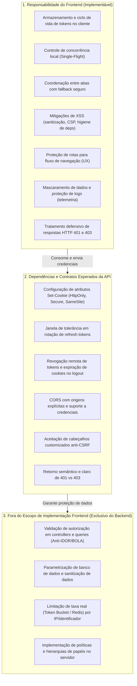
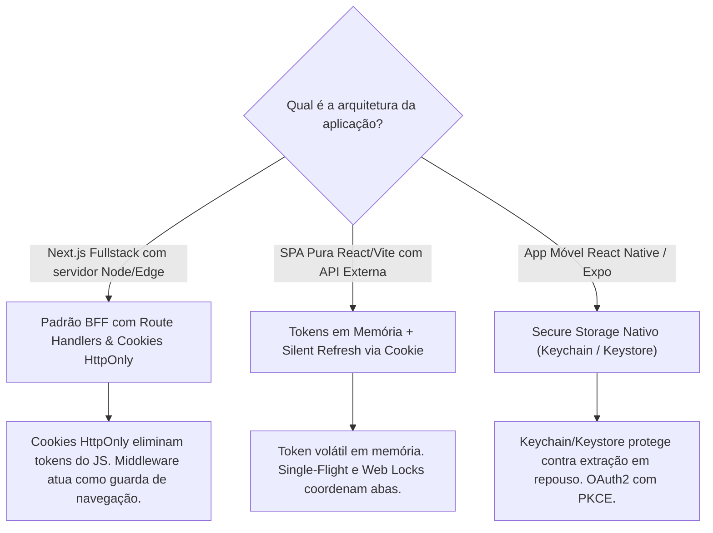

# Segurança de Autenticação e Checklist Frontend

Este documento estabelece as diretrizes de segurança, análise de vulnerabilidades, boas práticas e critérios de validação para a arquitetura de **autenticação e autorização no frontend**.

---

## 1. Delimitação de Escopo: Frontend vs. Dependências da API

Para que a análise arquitetural seja precisa, as responsabilidades de segurança devem ser categorizadas em três domínios estritos:



### 1.1 Responsabilidades de Implementação do Frontend:
- Escolher e gerenciar a estratégia de armazenamento do token no cliente de acordo com a arquitetura.
- Implementar controle de concorrência para evitar chamadas de renovação redundantes (*Single-Flight*).
- Verificar compatibilidade de APIs do navegador (ex: Web Locks API) com fallback seguro.
- Proteger o código contra XSS (higiene de dependências, sanitização de HTML, eliminação de `dangerouslySetInnerHTML`, configuração de CSP e proteção de logs).
- Implementar guardas de navegação no cliente para direcionamento de telas e feedback ao usuário (UX).
- Tratar respostas HTTP 401 (renovação/logout) e HTTP 403 (autorização insuficiente).

### 1.2 Dependências e Contratos Esperados da API:
- Emissão de cookies de sessão com atributos corretos (`HttpOnly`, `Secure`, `SameSite`).
- Suporte a revogação de sessão remota via endpoint de logout (ex: `POST /api/auth/logout`).
- Tolerância a concorrência através de janela de tolerância (*grace period*) caso utilize *Refresh Token Rotation* (RTR).
- Respostas semânticas diferenciando 401 (não autenticado) de 403 (não autorizado).
- Garantia de que cada endpoint valide a propriedade dos recursos (*Object-Level Access Control*).

### 1.3 Fora do Escopo de Implementação do Frontend:
- Regras de autorização em controllers, middlewares ou ORMs do backend.
- Rate limiting real em servidores, gateways ou proxies reversos.
- Lógica de banco de dados e rotação de chaves criptográficas.

---

## 2. Auditoria Técnica da Implementação do Projeto

Abaixo está a avaliação técnica dos 12 aspectos de segurança no contexto do frontend, confrontando o código do projeto com as boas práticas da indústria:

| Aspecto de Segurança | Classificação no Projeto | Diagnóstico Frontend e Dependências |
| :--- | :--- | :--- |
| **1. Armazenamento de Tokens** | **Parcialmente implementado** | O Access Token (JWT) é gravado em `localStorage` (`src/lib/auth.ts:31`), apresentando risco em caso de XSS. O Refresh Token é trafegado via cookie pelo navegador com `credentials: 'include'` (`src/services/api.ts:9`), dependendo da configuração da API. |
| **2. Segurança de Cookies** | **Dependência da API (Não verificável)** | O frontend envia `credentials: 'include'`. As diretivas (`HttpOnly`, `Secure`, `SameSite`) são de emissão exclusiva do backend Strapi, cujo código reside fora do workspace. |
| **3. Proteção contra XSS e CSRF** | **Parcialmente implementado** | O React protege a interpolação básica de JSX, mas o armazenamento em `localStorage` permanece vulnerável a scripts injetados. Contra CSRF, o frontend não injeta tokens anti-CSRF customizados, dependendo de defesas do servidor. |
| **4. Expiração, Renovação e Revogação** | **Parcialmente implementado** | Expiração tratada por interceptor HTTP 401 via `POST /api/auth/refresh`. Contudo, **o frontend não trata concorrência entre requisições** e **o logout não chama o endpoint de revogação da API**. |
| **5. Proteção de Endpoints** | **Dependência da API (Não verificável)** | O frontend envia `Authorization: Bearer <token>`, mas a aplicação de permissões e validação de propriedade do recurso é responsabilidade exclusiva da API. |
| **6. Autorização Baseada em Papéis (RBAC)** | **Ausência de evidências no frontend** | O frontend não possui contratos de permissões, papéis de usuário (`role`) ou controle condicional de elementos na interface. **Ressalva:** não se pode concluir que a API Strapi não possua RBAC interno. |
| **7. Proteção de Rotas no Frontend** | **Implementado e comprovado (Apenas UX)** | O layout `src/app/(painel)/layout.tsx` utiliza `useSyncExternalStore` conectado ao `src/lib/auth.ts`, prevenindo *state tearing* e renderizando `<Loading />`. *(Controle de navegação de interface, não autorização).* |
| **8. Logout e Encerramento de Sessões** | **Parcialmente implementado** | `removerToken()` apaga o token do `localStorage` e limpa o estado reativo, mas **não notifica a API para revogar o refresh token**, deixando a sessão ativa no servidor. |
| **9. Concorrência na Renovação de Tokens** | **Não implementado (Vulnerabilidade no Cliente)** | Requisições paralelas que recebem 401 disparam múltiplas chamadas simultâneas a `refreshAccessToken()`, quebrando aplicações caso o backend utilize rotação de tokens. |
| **10. Tratamento de HTTP 401 e 403** | **Parcialmente implementado** | HTTP 401 é tratado pelo interceptor de renovação. O **HTTP 403 (Forbidden)** é tratado como erro genérico de busca, sem tela de "Acesso Negado" ou tratamento específico. |
| **11. Rate Limiting e Tentativas Abusivas** | **Não implementado no cliente / Fora de escopo** | O formulário de login (`LoginForm.tsx`) não possui debouncing ou bloqueio visual. Contudo, defesas efetivas contra força bruta pertencem obrigatoriamente à infraestrutura da API. |
| **12. CORS e Credenciais** | **Parcialmente implementado** | O frontend utiliza `credentials: 'include'`, exigindo como contrapartida que a API responda com `Access-Control-Allow-Credentials: true` e `Origin` explícito. |

---

## 3. Aprofundamento dos Pontos Técnicos no Frontend

### 3.1 Concorrência no Refresh e a Web Locks API

Ao lidar com renovação de sessão sob concorrência, o frontend deve estruturar sua defesa em camadas:

#### Camada 1: O Padrão Single-Flight (No Mesmo Contexto JS)
Resolve a concorrência quando múltiplos componentes na **mesma aba ou janela** recebem 401 simultaneamente:

```ts
let refreshPromise: Promise<string> | null = null;

export async function refreshAccessTokenSingleFlight(): Promise<string> {
  if (refreshPromise) {
    return refreshPromise;
  }

  refreshPromise = (async () => {
    try {
      const response = await fetch(`${API_URL}/api/auth/refresh`, {
        method: 'POST',
        credentials: 'include',
      });

      if (!response.ok) throw new Error('Sessão expirada');
      const data = await response.json();
      if (!data.jwt) throw new Error('Token ausente');

      salvarToken(data.jwt);
      return data.jwt;
    } finally {
      refreshPromise = null;
    }
  })();

  return refreshPromise;
}
```

#### Camada 2: Coordenação Entre Abas com Web Locks API
A Web Locks API (`navigator.locks`) permite que abas diferentes no mesmo navegador coordenem a chamada de refresh para que apenas uma aba efetue a renovação por vez.

**Requisitos Críticos de Implementação no Frontend**:
1. **Verificação de Suporte no Ambiente**:
   Nem todos os navegadores, webviews ou ambientes de SSR suportam Web Locks. O frontend deve sempre verificar:
   ```ts
   const suportaWebLocks = typeof navigator !== 'undefined' && 'locks' in navigator;
   ```
2. **Tratamento de Indisponibilidade e Falhas**:
   Se a Web Locks API não estiver disponível ou a requisição do lock falhar (rejeição, timeout), o frontend deve fazer o *fallback* gracioso para o Single-Flight local sem quebrar a aplicação.
3. **Reavaliação Obrigatória do Token após Adquirir o Lock**:
   Quando a Aba B fica aguardando o lock que estava com a Aba A, a Aba A conclui o refresh e salva o novo token no armazenamento compartilhado. Quando a Aba B finalmente adquire o lock, **ela deve primeiro verificar se o token já foi renovado pela Aba A**. Se o token já for novo, ela não deve chamar o endpoint de refresh novamente!
4. **Limitações Inerentes**:
   - Web Locks coordena **apenas abas no mesmo navegador e mesma origem**. Ela **NÃO** coordena dispositivos diferentes (ex: celular e desktop) nem navegadores diferentes.
   - Não é uma solução obrigatória para todas as aplicações; seu uso justifica-se quando o backend adota *Refresh Token Rotation* (RTR) estrito sem tolerância.

```ts
// Exemplo arquitetural com verificação de suporte e reavaliação pós-lock
export async function refreshCoordenado(): Promise<string> {
  const tokenAtual = obterToken();

  if (typeof navigator !== 'undefined' && 'locks' in navigator) {
    try {
      return await navigator.locks.request('auth-refresh-lock', async () => {
        // REAVALIAÇÃO: enquanto esperava o lock, outra aba pode ter renovado o token
        const tokenRecente = obterToken();
        if (tokenRecente && tokenRecente !== tokenAtual) {
          return tokenRecente; // Já foi renovado por outra aba!
        }
        return await refreshAccessTokenSingleFlight();
      });
    } catch {
      // Fallback em caso de falha no lock
      return await refreshAccessTokenSingleFlight();
    }
  }

  // Fallback quando Web Locks não é suportado
  return await refreshAccessTokenSingleFlight();
}
```

---

### 3.2 Concorrência e Rotação de Refresh Tokens: Frontend vs. Backend

É essencial não confundir a coordenação do cliente com os mecanismos de proteção da API:

| Responsabilidade do Frontend | Responsabilidade da API (Contrato Esperado) |
| :--- | :--- |
| Agrupar chamadas de refresh via Single-Flight. | Implementar rotação atômica de refresh tokens no banco de dados. |
| Verificar se o token já foi atualizado antes de disparar nova chamada. | Fornecer **Janela de Tolerância (Grace Period)** de 15 a 30 segundos, aceitando o token anterior recentemente rotacionado para requisições em trânsito. |
| Tratar falhas no refresh limpando credenciais e redirecionando para login. | Invalidar toda a família de tokens caso um refresh token revogado seja reutilizado fora da janela de tolerância. |
| Abortar requisições retentadas se o refresh falhar em definitivo. | Emitir cookies seguros e expirar sessões revogadas. |

> [!IMPORTANT]
> **A Janela de Tolerância Pertence à API**: O frontend **não tem como implementar uma janela de tolerância de refresh sozinho**. Ela é uma característica do contrato da API. O frontend pode apenas se beneficiar dela para tolerar concorrência natural de rede.

---

### 3.3 Access Token em Memória e a Realidade do XSS

Muitas fontes de arquitetura sugerem "armazenar o Access Token apenas em memória JavaScript" como panaceia contra roubo de tokens. A documentação da skill deve desmistificar essa premissa:

#### O que o Armazenamento em Memória Resolve:
- Elimina a persistência do token em disco (`localStorage` / `sessionStorage`).
- Impede que scripts em ataques pós-sessão (ou extensões maliciosas inspecionando o storage após o fechamento da aba) extraiam o token armazenado.

#### O que o Armazenamento em Memória NÃO Resolve:
- **Não elimina os riscos de XSS ativo**: Se um script malicioso estiver em execução no contexto da página (via dependência comprometida ou injeção de HTML), o invasor não precisa do token bruto. Ele pode:
  1. Invocar diretamente as funções exportadas dos módulos da aplicação (ex: `apiFetch('/api/usuarios')`).
  2. Interceptar requisições ativas sobrescrevendo `window.fetch`.
  3. Ler variáveis de closure acessíveis ou inspecionar o estado do cliente.

#### Diretrizes Obrigatórias de Prevenção a XSS no Frontend:
1. **Evitar Renderização de HTML Não Confiável**:
   - Nunca utilizar `dangerouslySetInnerHTML` sem necessidade extrema.
   - Proibir interpolação de dados vindos do usuário ou da API diretamente em nós HTML crus.
2. **Sanitização Rigorosa**:
   - Quando for inevitável renderizar HTML rico vindo de CMS ou markdown, sanitizar o conteúdo obrigatoriamente através de bibliotecas especializadas e mantidas (ex: DOMPurify):
     ```ts
     import DOMPurify from 'dompurify';
     const htmlSeguro = DOMPurify.sanitize(conteudoNaoConfiavel);
     ```
3. **Prevenção de Execução Dinâmica de Scripts**:
   - Banir o uso de `eval()`, `new Function()`, `setTimeout(string)` e injeções dinâmicas de tags `<script>`.
4. **Content Security Policy (CSP)**:
   - Configurar cabeçalhos CSP estritos no servidor de borda ou meta tag:
     - Bloquear `unsafe-eval` e `unsafe-inline` (utilizar *nonces* ou *hashes* para scripts necessários).
     - Restringir `connect-src` exclusivamente aos domínios das APIs autorizadas.
5. **Higiene de Dependências na Cadeia de Suprimentos**:
   - Monitorar vulnerabilidades de pacotes regularmente (`npm audit`).
   - Evitar adicionar bibliotecas desnecessárias para tarefas triviais (filosofia *zero-dependency* para primitivas).
6. **Proteção de Informações Sensíveis em Logs e Telemetria**:
   - Garantir que interceptores de log, bibliotecas de APM e ferramentas de monitoramento de erros (Sentry, Datadog) apliquem regras de mascaramento (*redaction*) para **nunca enviar cabeçalhos `Authorization`, tokens ou CPFs para serviços de terceiros**.
7. **Reconhecer as Limitações do React**:
   - O React escapa automaticamente textos entre chaves (`<p>{texto}</p>`).
   - **O React NÃO protege**:
     - Atributos `href` contendo esquemas maliciosos como `<a href="javascript:...">`.
     - Atributos manipulados diretamente via refs (`ref.current.innerHTML = ...`).
     - Strings passadas para `dangerouslySetInnerHTML`.

---

### 3.4 Rate Limiting: Esclarecimento de Papéis

- **No Frontend**:
  - Implementar controles de interface (`loading`, botões desabilitados, debouncing de formulários).
  - **Classificação**: Recurso de **UX e Usabilidade**. Serve para guiar o usuário e evitar requisições acidentais em duplicidade.
- **Na API / Infraestrutura**:
  - Implementar rate limiting com *Leaky Bucket* ou *Token Bucket* no Gateway/WAF.
  - **Classificação**: Recurso de **Segurança da Informação**.
  - O frontend deve apenas estar preparado para receber e tratar a resposta **HTTP 429 (Too Many Requests)**, exibindo ao usuário o tempo de espera informado no cabeçalho `Retry-After`.

---

## 4. Adaptação a Diferentes Arquiteturas Frontend

A skill não deve impor uma única estratégia de armazenamento ou arquitetura sem avaliar o contexto do projeto:



1. **Next.js Fullstack (BFF)**:
   - Se o projeto possui servidor Next.js atuando como camada intermediária, priorizar Route Handlers internos emitindo cookies `HttpOnly` e `SameSite`. Isso remove completamente os tokens do alcance do JavaScript do navegador.
2. **SPA Pura (React / Vite + API Externa)**:
   - Se o projeto for estático (hospedado em S3/Cloudflare Pages) consumindo uma API em domínio diferente:
     - Manter o Access Token em memória volátil de JavaScript.
     - Utilizar o Refresh Token via cookie seguro da API.
     - Implementar Single-Flight e, quando justificado, Web Locks API com fallback.
3. **Aplicações Móveis (React Native / Expo)**:
   - Utilizar armazenamento seguro nativo (`expo-secure-store`, Keychain/Keystore).
   - Fluxos OAuth2 com PKCE.

---

## 5. Checklist de Auditoria de Segurança para o Frontend

Ao analisar ou orientar a arquitetura frontend de um novo projeto, utilize este checklist:

### Gestão de Sessão e Tokens (Frontend):
- [ ] O frontend evita armazenar tokens de acesso em `localStorage` quando há alternativas viáveis (cookies HttpOnly via BFF ou memória volátil)?
- [ ] As requisições de renovação implementam bloqueio de concorrência (*Single-Flight*) para chamadas na mesma aba?
- [ ] Se a aplicação utiliza Web Locks API para coordenação entre abas, o suporte do navegador é verificado com fallback seguro?
- [ ] Após adquirir o lock entre abas, o frontend reavalia se o token já foi renovado antes de disparar nova requisição?
- [ ] O fluxo de logout dispara a notificação para a API revogar a sessão no servidor, além de limpar o estado local?

### Resiliência e Tratamento de Respostas (Frontend):
- [ ] A aplicação trata o status **HTTP 403 (Forbidden)** com tela ou mensagem de "Acesso Negado", diferenciando de falha de autenticação (401)?
- [ ] A aplicação trata o status **HTTP 429 (Too Many Requests)** respeitando o cabeçalho `Retry-After` quando retornado?
- [ ] O interceptor de rede aborta retentativas em caso de falha definitiva de renovação, evitando loops infinitos?

### Defesa contra XSS e Proteção de Dados (Frontend):
- [ ] O projeto proíbe o uso de `dangerouslySetInnerHTML` sem sanitização via DOMPurify?
- [ ] Links dinâmicos (`<a href={url}>`) validam se o protocolo é seguro, impedindo `javascript:`?
- [ ] O projeto não utiliza `eval()` nem injeções dinâmicas de código?
- [ ] As ferramentas de telemetria e logs (Sentry, Datadog, console) possuem regras ativas para mascarar tokens, senhas e CPFs?
- [ ] As dependências do projeto são auditadas regularmente contra vulnerabilidades conhecidas?

### Contratos e Validações Esperados da API:
- [ ] A API foi documentada com a exigência de validar autorização e propriedade de recursos em cada endpoint (anti-IDOR/BOLA)?
- [ ] A API configura cookies com atributos `HttpOnly`, `Secure` e `SameSite` adequados?
- [ ] Se a API adotar rotação estrita de refresh tokens, foi verificado se ela disponibiliza janela de tolerância para concorrência de rede?
