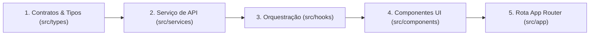

# Convenções de Desenvolvimento e Extensão

Este documento serve como guia prático para desenvolvedores e agentes de IA ao adicionar novas funcionalidades, criar módulos ou manter a coerência arquitetural da aplicação.

---

## 1. O Fluxo de Construção de uma Nova Funcionalidade

Ao implementar uma nova entidade ou funcionalidade no sistema, siga rigorosamente a ordem das camadas: da modelagem de dados para a interface.



---

### Passo 1: Definir Contratos e Tipos (`src/types/<entidade>.ts`)
1. Crie o arquivo de tipagem no singular (ex: `servico.ts`).
2. Defina a interface principal com os campos retornados pelo Strapi (`id`, `documentId`, etc.).
3. Implemente a função de mapeamento/sanitização (`map<Entidade>`) para garantir que valores ausentes ou nulos não quebrem a renderização.

```ts
// Exemplo: src/types/servico.ts
export interface Servico {
  id?: number;
  documentId?: string;
  nome: string;
  preco: number;
  duracaoMinutos: number;
}

export function mapServico(data: Servico): Servico {
  return {
    id: data.id,
    documentId: data.documentId,
    nome: data.nome ?? '',
    preco: Number(data.preco) || 0,
    duracaoMinutos: Number(data.duracaoMinutos) || 30,
  };
}
```

---

### Passo 2: Implementar o Serviço de API (`src/services/<entidade>.service.ts`)
1. Isole os endpoints REST da entidade.
2. Utilize `apiGet` para consultas e `apiFetch` para mutações (POST, PUT, DELETE).
3. Lembre-se do padrão do Strapi: mutações exigem o envelope `{ data: { ...campos } }`.
4. Utilize `obterMensagemErro` para capturar mensagens legíveis do servidor.

```ts
// Exemplo: src/services/servicos.service.ts
import { Servico, mapServico } from '../types/servico';
import { StrapiCollectionResponse, StrapiItemResponse } from '../types/strapi';
import { apiFetch, apiGet, obterMensagemErro } from './api';

export async function getServicos(): Promise<Servico[]> {
  const json = await apiGet<StrapiCollectionResponse<Servico>>('/api/servicos');
  return json.data.map(mapServico);
}

export async function criarServico(servico: Omit<Servico, 'id' | 'documentId'>): Promise<Servico> {
  const response = await apiFetch('/api/servicos', {
    method: 'POST',
    body: JSON.stringify({ data: servico }),
  });

  if (!response.ok) {
    throw new Error(await obterMensagemErro(response, 'Erro ao criar serviço'));
  }

  const json: StrapiItemResponse<Servico> = await response.json();
  return mapServico(json.data);
}
```

---

### Passo 3: Implementar o Custom Hook de Orquestração (`src/hooks/use<Entidade>.ts`)
1. Gerencie os estados `dados`, `loading`, `error` e o gatilho `versao`.
2. Aplique a flag de cancelamento `ativo` para evitar vazamento de memória.
3. Exponha o método `recarregar()` via `useCallback`.

```ts
// Exemplo: src/hooks/useServicos.ts
'use client';

import { useCallback, useEffect, useState } from 'react';
import { getServicos } from '@/src/services/servicos.service';
import type { Servico } from '@/src/types/servico';

export function useServicos() {
  const [servicos, setServicos] = useState<Servico[]>([]);
  const [loading, setLoading] = useState(true);
  const [error, setError] = useState<string | null>(null);
  const [versao, setVersao] = useState(0);

  useEffect(() => {
    let ativo = true;

    async function carregar() {
      try {
        setLoading(true);
        setError(null);
        const lista = await getServicos();
        if (ativo) setServicos(lista);
      } catch (err) {
        if (ativo) setError(err instanceof Error ? err.message : 'Erro ao carregar serviços');
      } finally {
        if (ativo) setLoading(false);
      }
    }

    carregar();
    return () => { ativo = false; };
  }, [versao]);

  const recarregar = useCallback(() => setVersao((v) => v + 1), []);

  return { servicos, loading, error, recarregar };
}
```

---

### Passo 4: Criar os Componentes de Domínio (`src/components/<Dominio>/`)
1. Crie uma pasta sob `src/components/` com nome em PascalCase.
2. Separe o componente em `index.tsx` e estilos em `styles.ts`.
3. Validação de formulários: implemente a função pura `validar(dados)` localmente, retornando objeto de erros tipado.
4. Mantenha os componentes acessíveis com atributos ARIA e papéis semânticos.

---

### Passo 5: Criar a Página no Next.js App Router (`src/app/(painel)/<modulo>/page.tsx`)
1. Se a tela for restrita ao painel autenticado, posicione-a dentro do Route Group `(painel)/`.
2. Declare `'use client'` no topo do arquivo caso utilize hooks ou eventos de clique.
3. Utilize `<Header title="..." />` e `<PageBody>` para herdar a casca estrutural.
4. Trate os estados: `<Skeleton />` durante carregamento, `<ErrorState />` em falhas e `<EmptyState />` quando a lista estiver vazia.

---

## 2. Padrões Arquiteturais de Acessibilidade (A11y)

A acessibilidade no projeto é tratada como um requisito arquitetural estrutural:

1. **Semântica HTML**:
   - Utilize marcas estruturais nativas: `<main>`, `<section>`, `<header>`, `<nav>`.
   - Modais e gavetas devem conter `role="dialog"`, `aria-modal="true"` e serem identificados por `aria-labelledby`.
2. **Focus Management (Captura e Restituição de Foco)**:
   - Em modais (`src/components/Modal/shared.tsx`), ao abrir o diálogo, o foco deve ser retido internamente (`useFocusTrap`). Ao fechar, o foco deve retornar ao gatilho original que abriu o diálogo.
3. **Controle de Teclado**:
   - Diálogos e gavetas devem responder à tecla Escape (`useEscapeKey`).
   - Toasts e alertas clicáveis devem ser acionáveis por `Enter` ou `Espaço`.
4. **Alerta a Leitores de Tela**:
   - Erros de formulário devem conter `role="alert"`.
   - Regiões de notificação devem conter `role="region"` ou `role="status"`.

---

## 3. Guia de Diagnóstico Arquitetural para Outros Agentes

Quando um agente for aplicar este blueprint em um projeto novo ou desconhecido, ele deve executar o seguinte checklist diagnóstico antes de propor qualquer modificação:

1. **Inspeção de Dependências**:
   - Verifique o `package.json` para identificar framework (Next.js, Vite, Remix), versões de React e ferramentas ativas.
   - Verifique dependências instaladas que não estão sendo utilizadas (como o Tailwind neste projeto) para não assumir premissas falsas.
2. **Mapeamento de Rotas e Layouts**:
   - Identifique se o projeto utiliza App Router (`app/`) ou Pages Router (`pages/`).
   - Verifique como as rotas são protegidas (Middleware, Route Groups, Guards em Layout).
3. **Mapeamento do Acesso a Dados**:
   - Descubra o padrão do backend (Strapi REST, GraphQL, Firebase, API proprietária).
   - Localize o cliente HTTP central e verifique se há interceptores de autenticação configurados.
4. **Verificação de Camadas Existentes**:
   - Respeite as divisões existentes. Se o projeto utiliza `services/` e `hooks/`, não crie camadas estranhas como `controllers/` ou `repositories/` sem justificativa explícita.
5. **Evite Abstrações Prematuras**:
   - Não adicione bibliotecas externas (Zod, React Hook Form, Zustand, Axios) se o projeto já resolve suas necessidades com TypeScript nativo e React Hooks.

